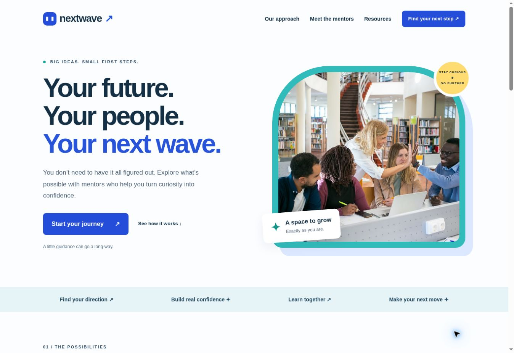

# NextWave — Youth Mentorship

A responsive, accessible sample youth mentorship website built with plain HTML, CSS, and JavaScript. It introduces program goals, fictional mentors, learning activities, and a privacy-friendly demo join experience.

## Screenshot



## Local setup

No dependencies or build step required. Open `index.html` directly, or serve this directory with Python 3:

```sh
python3 -m http.server 8000
```

Visit http://localhost:8000. Stop the server with Ctrl+C.

## Project structure

```text
index.html
css/style.css
js/script.js
images/                 Licensed stock photos, original logo, and screenshot
README.md
LICENSE
.gitignore
.openai/hosting.json     Sites deployment configuration
```

## Features

- Welcome, program goals, mentor profiles, expandable resources, and demo join section.
- Responsive layouts, mobile navigation, semantic landmarks, skip link, visible focus, reduced-motion support, and keyboard controls.
- Native expandable activities work without JavaScript. Navigation remains available without JavaScript.
- Demo form asks only for a sample interest. No name, email, backend, analytics, cookies, browser storage, or form transmission. Selection resets on reload.
- All people, roles, quotes, and the program are fictional examples; this is not a registration service.

## Test locally

1. Check desktop and 390px phone widths; confirm no horizontal scrolling.
2. Tab from the skip link through navigation and controls. Press Enter to follow links and Space/Enter to expand activities.
3. At phone width, open the Menu, check its expanded state, follow a link, and press Escape to close it.
4. Try submitting without an interest (native validation), then choose each interest and submit. Confirm a relevant message appears without a page reload or network request.
5. Reload: the selected interest and message should reset. Disable JavaScript: navigation and learning activities should remain usable.
6. Follow every section link, inspect developer tools for console errors, and ensure local assets load. Respect reduced-motion settings.

## Contributing

1. Fork the repository and create a branch for your change.
2. Keep the HTML/CSS/JS/images folder structure and use relative asset paths.
3. Make focused changes; do not add secrets, personal information, trackers, or unlicensed content.
4. Run the checks above and include relevant screenshots in your pull request.
5. Describe the change and test results, then open a pull request.

## Credits and license

Created for MiLASHA69-Dc with OpenAI Codex. Original text and SVG artwork were created for this project. Photography is by Kampus Production, Monstera Production, furkan karakuş, PON official, and SXYLEN on Pexels. See [THIRD_PARTY.md](THIRD_PARTY.md) for individual photo sources and licensing. The screenshot depicts this site. Sample mentor names, roles, and quotations are fictional; photographed models are not actual mentors or program participants. No affiliation or endorsement is implied. Nationalities are not asserted for stock-photo subjects.

Code and original project artwork: MIT License. Copyright (c) 2026 MiLASHA69-Dc. Third-party photographs remain under the Pexels License and are not relicensed under MIT. See [LICENSE](LICENSE) for the full terms.
